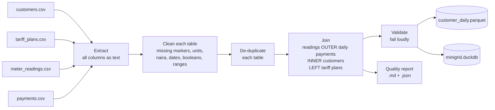

# Mini-Grid Data Integration Pipeline

A Python pipeline that cleans four messy source files from a solar mini-grid operator and merges them into one analysis-ready table: **one row per customer per day**, loaded into CSV, Parquet and DuckDB, with a quality report that accounts for every row.

Its SQL companion, [minigrid-sql-analytics](https://github.com/QuinnDavids/minigrid-sql-analytics), solves the same problem entirely in SQL and answers six business questions from the same data.

## The problem

A solar mini-grid operator in Nigeria keeps customer data in four files, each maintained by a different team:

| File | Kept by | What it holds |
|---|---|---|
| `customers.csv` | Field sales | Who the customer is, community, household size, tariff plan |
| `tariff_plans.csv` | Commercial | Plan names and price per kWh |
| `meter_readings.csv` | Operations | Daily energy use, peak load, outage hours |
| `payments.csv` | Finance | Top-ups by USSD, bank transfer, POS and card |

Each team types things its own way: `"800 Wh"` next to `"1.2kwh"`, `"₦5,000"` next to `"NGN 5000"`, `05/03/2026` next to `5 Mar 2026`, duplicate rows, impossible values, and payments from customer IDs nobody recognises. Analysts were cross-referencing these by hand. This pipeline does it automatically and repeatably.

## Data flow



## What the pipeline does, step by step

1. **Extract** every CSV with every column as text, so nothing is converted before we decide what it means.
2. **Clean each table** with small, tested helpers in `clean.py`:
   - one definition of "missing" (`""`, `N/A`, `none`, `-`, `null`) used everywhere
   - IDs trimmed and upper-cased (`" mg-0042 "` → `MG-0042`)
   - numbers pulled out of text with a regular expression and converted (`800 Wh` → `0.8` kWh)
   - naira amounts read in any format (`₦5,000`, `N5,000`, `NGN 5000`, `5000.00`)
   - dates parsed in layers: ISO first, then slash dates, then named months
   - yes/no flags mapped from known spellings only
   - impossible values (negative energy, 99 kW peak load, 30 outage hours) set to missing
3. **De-duplicate** each table before joining. Exact copies are dropped; rows that share a key but disagree are merged by keeping the first non-missing value in each column.
4. **Roll payments up** to one row per customer per day, counting only payments that were definitely not reversed.
5. **Join** the tables (see the decisions below).
6. **Validate** the final table: unique keys, no missing keys, every value in range. If any check fails, the pipeline stops and nothing is saved.
7. **Load** to `data/processed/customer_daily.parquet`, `customer_daily.csv` (opens in Excel) and `data/processed/minigrid.duckdb` (the final table plus the four cleaned source tables).
8. **Report**: `reports/quality_report.md` and `.json` list rows in and out, duplicates removed, every value blanked by each rule, and checks that the numbers add up.

## Key design decisions

| Decision | Why |
|---|---|
| **Slash dates are day-first** (`05/03/2026` = 5 March) | The Nigerian convention. `2026/03/05` (year first) is recognised separately. |
| **Read everything as text** | If pandas guesses types, a phone number like `08031234567` loses its leading zero and `"N/A"` silently becomes missing. We decide, not pandas. |
| **Bad values become missing; rows are not deleted** | A reading with a broken peak-load value still has a good energy value. Deleting the row would throw that away. |
| **Readings OUTER JOIN daily payments** | A customer-day counts if the meter reported *or* the customer paid. An inner join would lose 837 days where someone paid but no reading arrived. |
| **INNER JOIN customers** | Payments from unknown customer IDs cannot be given a community or plan. They are dropped *and counted* in the report. |
| **LEFT JOIN tariff plans** | A customer with no plan on file keeps their rows; only the plan name and cost come out missing. |
| **Unknown reversed flags are excluded, never guessed** | `""` or `"maybe"` could be either. Counting them could overstate revenue, so they are left out of totals and reported. |
| **Every count reconciles** | Rows in = rows out + rows dropped + duplicates, for every table and for the join. The report shows pass/fail. |

## Results

From `reports/quality_report.md` (full report committed in `reports/`):

| Source | Rows in | Exact duplicates | Duplicates merged | Rows out |
|---|---:|---:|---:|---:|
| customers | 315 | 1 | 14 | 300 |
| tariff_plans | 16 | 12 | 0 | 4 |
| meter_readings | 32,200 | 920 | 613 | 30,667 |
| payments | 5,521 | 0 | 0 | 5,521 |

- **31,402 customer-days** in the final table, 300 customers, 2026-03-01 to 2026-06-28
- 633 energy values blanked (351 unreadable, 282 negative), 279 impossible peak loads, 327 impossible outage hours
- 154 reversed payments and 122 with an unknown reversed flag excluded from totals
- 108 orphan payments from 20 unknown customer IDs dropped
- All 6 reconciliation checks and all 14 validation checks pass

## How to run it

Needs Python 3.11 or newer. From the project folder, in VS Code's terminal:

```bash
# 1. Create and activate a virtual environment
python -m venv .venv
.venv\Scripts\activate          # Windows
source .venv/bin/activate       # macOS / Linux

# 2. Install (this also installs the project itself, so "python -m pipeline" works)
pip install -r requirements.txt

# 3. Generate the data, run the pipeline, run the tests
python scripts/generate_data.py
python -m pipeline run
pytest
```

Outputs land in `data/processed/` and `reports/`:

| File | What it is | How to open it |
|---|---|---|
| `customer_daily.csv` | The final clean table | Excel, or any spreadsheet |
| `customer_daily.parquet` | The same table in a compact format data tools read fast | pandas, DuckDB, Power BI |
| `minigrid.duckdb` | A database holding the final table plus the four cleaned source tables | DuckDB, or Python (`duckdb.connect`) |

## Project structure

```
minigrid-data-pipeline/
├── scripts/generate_data.py   creates the four messy CSVs (seed 42)
├── src/pipeline/
│   ├── __main__.py            "python -m pipeline run": runs every step in order
│   ├── config.py              paths, missing markers, units, valid ranges, bands
│   ├── extract.py             reads CSVs as text
│   ├── clean.py               column-level cleaning helpers
│   ├── transform.py           cleans each table, de-duplicates, joins
│   ├── validate.py            final checks, fails loudly
│   ├── load.py                CSV, Parquet and DuckDB
│   └── quality.py             quality report
├── tests/                     118 tests
└── reports/quality_report.md  example output
```

## Tests

```bash
pytest          # 118 tests
ruff check .    # lint
```

- `tests/test_clean.py`: one group per cleaning helper, covering every messy format the generator creates
- `tests/test_transform.py`: each table's cleaning, de-duplication, the three joins and validation, on tiny hand-made tables
- `tests/test_pipeline.py`: generates fresh data, runs the whole pipeline, checks outputs, reconciliation and the DuckDB tables

## Disclosure

> This project re-implements the approach I used in the DataCamp Professional Data Engineer certification practical exam. Because certification tasks may be reused, the scenario, dataset and code here are new: the data is synthetic and generated by `scripts/generate_data.py`. The underlying data engineering principles are the same.

Names, communities, phone numbers and tariff prices are illustrative; email addresses use the reserved `example.com` domain.

## Tools used

Python, pandas, NumPy, pyarrow (Parquet), DuckDB, pytest, ruff.
